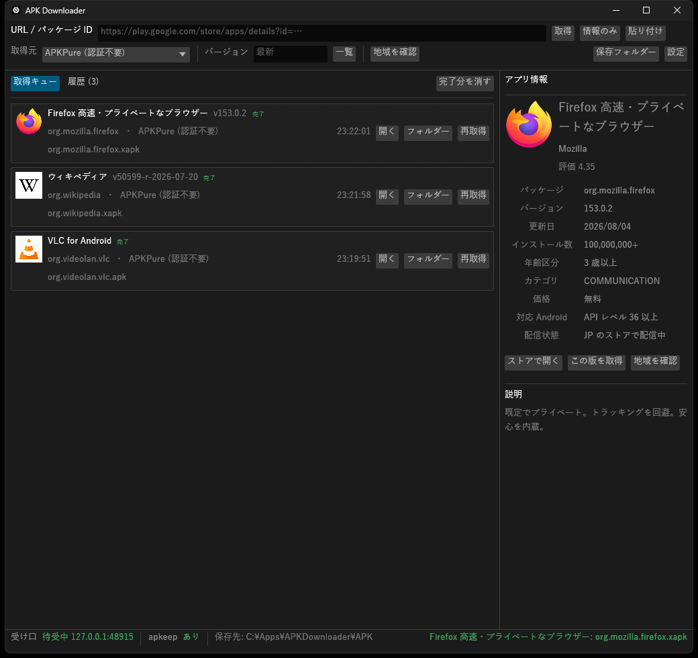
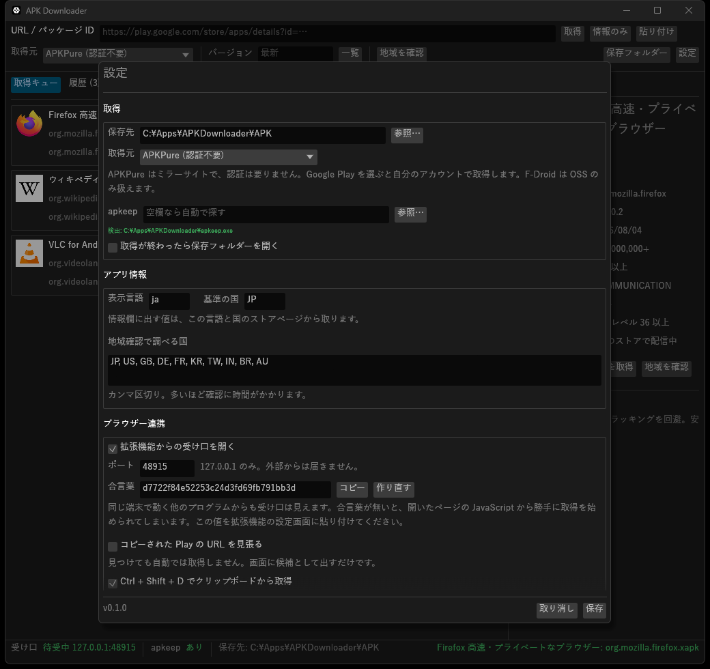
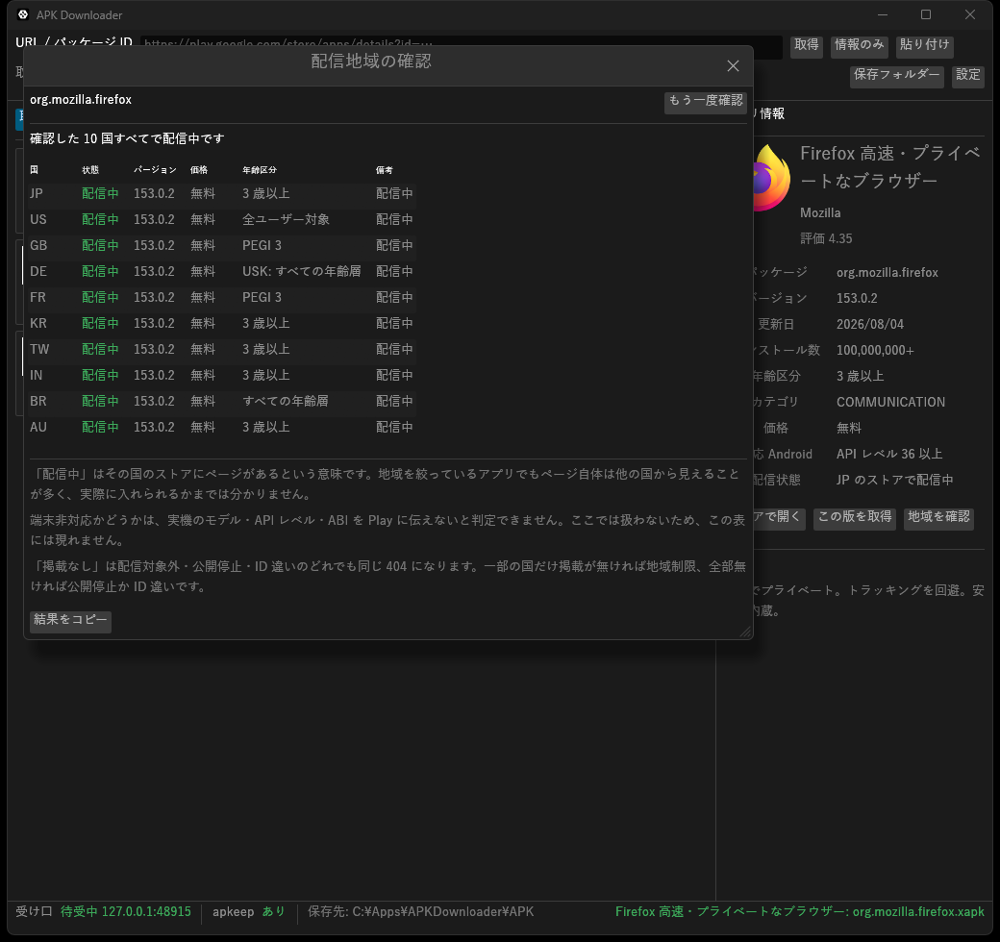

# APK Downloader

Google Play アプリの取得操作を簡略化する Windows 常駐ツール。

ブラウザーで開いている Google Play のページを右クリックするだけで、常駐アプリへ URL が渡り、
アプリ情報の取得と APK のダウンロードが始まる。Rust + egui / eframe 製の単体 EXE。

---

## できること

| 仕様 | 実装 |
|---|---|
| ブラウザー右クリックから取得開始 | Manifest V3 拡張 (Chrome / Edge / Firefox) → localhost 受け口 |
| 代替手段 | URL コピー検出 / ホットキー (Ctrl+Shift+D) / 手入力 |
| アプリ情報取得 | 名前・Package ID・開発者・アイコン・更新日時・配信状態・年齢区分・インストール数など |
| APK 取得管理 | 保存先設定・ダウンロード履歴・状態表示・出力ログ |
| 地域/配信制限確認 | 国ごとの掲載有無・バージョン・価格・年齢区分の一覧比較 |
| 常駐機能 | タスクトレイ・通知・設定・履歴・保存フォルダー表示 |

---

## 画面

URL を入れるか、ブラウザーの右クリックから送ると一覧に積まれる。右側は選んだアプリの情報。



**設定 → ブラウザー連携。** ここのポートと合言葉を拡張の設定画面へ貼り付ける。



`地域を確認` を押すと、設定した国のストアの掲載状況を並べる。



---

## 必要なもの

### 1. 本体

`cargo build --release` で `target/release/APKDownloader.exe` ができる。1 ファイルで動く。
設定・履歴・ログは EXE の隣の `data/` に置かれる (Portable)。書き込めない場所に置いた場合だけ
`%APPDATA%\APKDownloader` へ逃げる。

### 2. apkeep (APK の取得を担当)

**このアプリ単体では APK をダウンロードできない。** 取得部は外部ツール
[apkeep](https://github.com/EFForg/apkeep) (EFF 製・MIT) に任せている。

```bash
cargo install apkeep
```

または [Releases](https://github.com/EFForg/apkeep/releases) から `apkeep.exe` を取得し、
`APKDownloader.exe` と同じフォルダー (または `tools/`) に置く。設定画面から明示的に指定してもよい。

導入されていれば、ステータスバーの `apkeep` が「あり」になる。

#### なぜ外部ツールなのか

Google Play には APK を配る公開 API が無い。取得するには端末を騙る非公開プロトコルを
実装するか、ミラーサイトを叩くしかない。どちらも「どこから・どういう資格で取るか」は
利用者が選べるべきなので、その判断を `apkeep` に委ね、こちらは URL の解釈・情報表示・
履歴・常駐に専念している。取得元の仕様変更に追随する責任もこのアプリの外に出せる。

#### 取得元

| 取得元 | 認証 | 備考 |
|---|---|---|
| APKPure (既定) | 不要 | ミラーサイト。動作確認済み |
| Google Play | 要 | 自分の Google アカウント (メールアドレス + AAS トークン) |
| F-Droid | 不要 | OSS のみ。**apkeep 1.0.0 では現在使えない** (下記) |

**F-Droid について。** apkeep 1.0.0 は F-Droid の索引の検証に失敗する
(`Could not verify F-Droid package index. Exiting.` / 実測 2026-08)。apkeep 側の問題なので
このアプリからは直せない。取得元を選べるようにはしてあるので、apkeep が直れば設定を変えるだけで使える。

**apkeep の終了コードを信用していない理由。** 取得元にアプリや版が無いとき、apkeep は
エラーを出さず**終了コード 0 で黙って終わる**。そのため保存先にファイルが増えたかどうかで
成否を判定している。

保存先に同じ名前のファイルが既にあるときも、apkeep は `Downloading …` と出したうえで
何もせず 0 で終わる。出力からは「無かった」と区別できないので、保存先を見て見分けている。

- 既にあるファイルが**取得しきったもの**なら、取得済みとして扱う (再取得はしない)
- **途中で切れたもの** (中断した取得の残り) なら、そのファイルの場所を示して止まる。
  消してからやり直すこと。zip の終端記録があるかどうかで判定している

Google Play を使う場合の AAS トークンの取り方は apkeep の `USAGE-google-play.md` を参照。
トークンは設定ファイルに平文で保存されるので、共有 PC では扱いに注意すること。

---

## ブラウザー拡張の導入

`extension/` を読み込む。

### Chrome / Edge

1. `chrome://extensions` (Edge は `edge://extensions`) を開く
2. 「デベロッパーモード」を有効にする
3. 「パッケージ化されていない拡張機能を読み込む」で `extension/` を選ぶ

### Firefox

1. `extension/manifest.firefox.json` を `manifest.json` にリネーム (または上書きコピー)
   - Firefox は MV3 でも `service_worker` を受け付けないため、`background.scripts` を使う版が要る
2. `about:debugging#/runtime/this-firefox` →「一時的なアドオンを読み込む」で `manifest.json` を選ぶ

**コマンドラインからは読み込めない。** Chrome 137 以降は `--load-extension` が無効化され、
150 では解除用のフラグ (`--disable-features=DisableLoadExtensionCommandLineSwitch`) も
効かない (実測 2026-08)。上の画面操作で読み込むこと。Edge 150 では解除フラグが効いたので、
自動での確認が要るときは Edge を使う。

### 接続設定

1. 常駐アプリの **設定 → ブラウザー連携** を開く
2. 「ポート」と「合言葉」をコピー
3. 拡張のオプション画面に貼り付けて保存
4. 「接続を確認」でつながることを確かめる

Google Play のアプリページで右クリック →「APK Downloader で取得」。

項目はアプリページの**どこを右クリックしても**出る (アイコン・スクリーンショット・リンクの上でも)。
別のアプリへのリンクを右クリックした場合は、そのリンク先のアプリを取りに行く。

動作確認済み: Chrome / Edge 150 / Firefox 153。いずれも実際に右クリックして項目を押し、
常駐アプリが受け取って APK を取得するところまで確認している (Chrome は上の画面操作で
読み込んで手動確認)。

---

## 受け口 (localhost API)

拡張のためのごく小さな HTTP の口。**127.0.0.1 のみに束縛**しており、LAN の他機からは届かない。

| メソッド | 経路 | 認証 | 説明 |
|---|---|---|---|
| GET | `/ping` | 不要 | 起動確認。`{"ok":true,"app":"APKDownloader","version":"…"}` |
| POST | `/enqueue` | 要 | `{"url": "<Play の URL または パッケージ ID>"}` |
| GET | `/enqueue?url=…&token=…` | 要 | ブックマークレット等からの簡易呼び出し |
| POST | `/show` | 要 | ウィンドウを出す。トレイ格納中に EXE をもう一度起動したとき、2 つ目のインスタンスがこれを呼ぶ |

認証はヘッダー `X-APKD-Token`、または `token` クエリ。

**合言葉を無効にしないこと。** localhost に開いた口は、同じ端末で動くあらゆるプロセス —
閲覧中のページが走らせる JavaScript を含む — から叩ける。無認証だと、ページを開いただけで
任意のアプリをダウンロードさせられる。

---

## 使い方

- **取得**: URL 欄に貼って `取得` (Enter でも可)
- **情報のみ**: ダウンロードせず情報だけ見る
- **バージョン指定**: `一覧` で取得元にある版を調べ、押すと指定欄に入る
- **地域を確認**: 設定した国を横断してストアの掲載状況を並べる
- **✕ ボタン**: 終了せずトレイへ格納 (設定で変更可)。終了はトレイの右クリックメニューから
  - トレイに入れたあとで出したいときは、トレイアイコンをダブルクリックするか、EXE をもう一度起動する
  - **トレイアイコンが見当たらないとき**は、タスクバーの `^` (隠れているインジケーター) の中にある。
    Windows は新しいトレイアイコンを既定で隠すので、常に出したいならそこから引き出して固定する

### 終了したときの取得

**終了すると、取得中のダウンロードもその場で止まる。** apkeep はこのアプリと運命を共にする
ジョブへ入れてあり、強制終了や異常終了でも道連れになる。終了したのに回線とディスクを
使い続けるプロセスが残らないようにするため。

途中まで書かれたファイルは保存先に残る。同じアプリを取り直すときはそれを消すこと
(消さないと apkeep が「既にある」と見なして飛ばす。アプリはその状況を検出して案内する)。

### クリップボード監視とホットキー

どちらも既定では「候補を出すだけ」で、**勝手にダウンロードは始めない**。

- クリップボード監視: Play の URL をコピーすると画面上部に候補が出る。取得するかは利用者が選ぶ
- ホットキー `Ctrl + Shift + D`: クリップボードの URL で取得を開始する (これは明示操作なので即開始)

---

## 分かることと、分からないこと

情報表示は「読み取れた事実」だけを出し、推測で埋めない。取れなかった項目は「取得できず」と表示する。

- **バージョン**: 公開しているアプリとしていないアプリがある。公開していれば表示する
  (実測: Hulu は `6.31.0+17377884-google`)。していなければ「ストアが公開していません」と出す
  (実測: YouTube / VLC / WhatsApp / LINE はいずれも非公開)。実際に取得できる版は `一覧` で調べる
- **配信地域**: 分かるのは**ストアのページがその国にあるか**であって、その国で**入れられるか**ではない。
  地域を絞っているアプリでもページ自体は全世界に出ることが多い (実測: Hulu・Google Pay India は
  10 か国すべてで「配信中」)。「配信中」は「ページがある」と読むこと
- **掲載なしの理由**: 「掲載なし」は 404 のこと。Play は配信対象外・公開停止・ID 違いのいずれでも
  404 を返し、この 3 つは区別できない。一部の国だけ掲載が無ければ地域制限、全部無ければ
  公開停止か ID 違い、と読む
- **端末非対応**: 判定していない。実機のモデル・API レベル・ABI を Play に送らないと決まらないため

---

## 開発

```bash
cargo build          # debug。ウィンドウタイトルに [DEBUG] が付き、release と同時起動できる
cargo test           # 単体テスト
cargo test -- --ignored --nocapture   # 実物に当てる確認 (通信あり / apkeep 導入済みが前提)
```

debug と release は設定フォルダー (`data-debug` / `data`)、ポート (48916 / 48915)、
名前付きミューテックスをそれぞれ分けてあるので、並行して起動して比較できる。

### Play のページ構造が変わったとき

アプリ情報は 2 つの経路で読んでいる。

1. `<script type="application/ld+json">` — 名前・開発者・アイコン・年齢区分。安定している
2. `AF_initDataCallback({key:'ds:5', …, data:[…]})` — 更新日時・インストール数など。
   **キー名が無く添字頼り**なので、Google 側の変更で外れる

2 が外れると更新日時などが「取得できず」になる。そのときは推測で添字をいじる前に、
実物の構造を見ること:

```bash
cargo test dump_ds_layout -- --ignored --nocapture
```

### ファイル構成

```
src/
  main.rs        起動・多重起動防止
  app.rs         状態と logic() (描画しない処理)
  ui.rs          主画面の描画
  dialogs.rs     設定 / 地域確認ウィンドウ
  jobs.rs        取得ジョブの直列実行
  provider.rs    apkeep の駆動
  playstore.rs   ストアページの解析
  region.rs      国ごとの配信状況
  server.rs      localhost 受け口
  watcher.rs     クリップボード監視
  tray.rs        タスクトレイ
  icons.rs       アイコンの取得とテクスチャ化
  config.rs      設定
  history.rs     ダウンロード履歴
  paths.rs       Portable な保存先の決定
  fonts.rs       日本語フォントの読み込み
  notify.rs      完了通知
  logfile.rs     ファイルログ
  build_info.rs  debug/release の識別情報
extension/       ブラウザー拡張 (MV3)
```

---

## 注意

APK の取得は、Google Play の利用規約やミラーサイトの規約に触れる場合がある。
自分が権利を持つアプリの取得、手元の端末へのインストール、検証目的など、
利用者の責任で適法な範囲で使うこと。取得元の選択と資格情報の管理は利用者に委ねている。

---

## ライセンス

MIT。全文は [LICENSE](LICENSE)。

依存クレートの権利表示は [THIRD-PARTY-NOTICES.md](THIRD-PARTY-NOTICES.md) に収録した
(303 クレート / ライセンス本文 205 種)。Rust は依存を静的リンクするので、MIT や BSD の
ように「著作権表示を残す」ことを条件にするライセンスの義務が、配布する実行ファイル側に乗る。
生成は `tools/make-notices.ps1`。`cargo metadata --filter-platform` が返す、実際に
リンクされるクレートだけを対象にしている。

取得部の [apkeep](https://github.com/EFForg/apkeep) は別の実行ファイルなので、この表示には
含めていない。EXE と一緒に同梱して配る場合は、apkeep 側の MIT ライセンス本文も添えること。